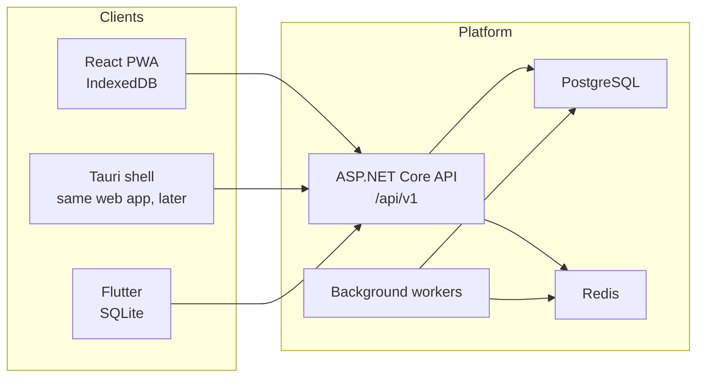

# Architecture

Status: foundation decisions are finalized. Business modules are not implemented. This document is the map; the linked documents hold the detailed strategies.

The product is a multi-tenant, offline-first warehouse management SaaS. The server is the authority for permissions, tenant status, subscription entitlements, inventory validation, and posted transactions. Clients are the authority only for work that has not been synchronized yet.

Inventory correctness outranks UI convenience. Data integrity outranks implementation speed.

## System context



Clients keep a local database and an outbox. They push operations, then pull changes since a checkpoint. They do not each receive a full copy of the tenant.

## Technology

| Area | Choice | Reason |
| --- | --- | --- |
| API | ASP.NET Core on .NET 8 | Latest stable LTS installed here. .NET 10 on this machine is a preview and is not used. |
| Data | PostgreSQL 16, EF Core migrations | Required store. Migrations are the only schema change path. |
| Cache / coordination | Redis 7 | Rate limits, short-lived auth state, and worker coordination when those features exist. |
| Validation | FluentValidation | Application-layer input rules. Added with the first module that needs it. |
| Logging / traces | Serilog, OpenTelemetry | Structured logs and traces. Correlation id is already on every request. |
| Auth tokens | JWT access token, rotating refresh token | Refresh tokens are stored only as a hash. |
| Web | React, TypeScript, Vite, IndexedDB, service worker | One frontend. A later Tauri shell may wrap it. Electron is out of scope. |
| Mobile | Flutter, Dart, SQLite via Drift | Offline-first. Secure storage for refresh tokens. |

Package references for FluentValidation remain deferred until a module adopts it. Serilog, OpenTelemetry, and Redis health checks are present in the API host (Phase 12). EF Core, Npgsql, and EFCore.NamingConventions remain in Infrastructure for the database foundation.

## Solution layout

```text
src/Warehouse.Domain            Pure domain. No framework references.
src/Warehouse.Application       Use cases and ports. References Domain only.
src/Warehouse.Infrastructure    Persistence, identity, brokers. References Application and Domain.
src/Warehouse.Shared            API contracts shared by the host. No project references.
src/Warehouse.Api               Composition root and HTTP. References Application, Infrastructure, Shared.
tests/Warehouse.UnitTests
tests/Warehouse.IntegrationTests
tests/Warehouse.ArchitectureTests
clients/web                     React + TypeScript + Vite. Arabic (RTL) default + English (LTR).
clients/mobile                  Not scaffolded. See the Flutter strategy.
docs/
```

Dependency rule, enforced by `ProjectReferenceTests` and `LayerDependencyTests`:

```text
Api -> Application, Infrastructure, Shared
Infrastructure -> Application, Domain
Application -> Domain
Domain -> nothing
Shared -> nothing
```

The API does not reference Domain directly. Controllers and endpoints stay thin. Business rules live in Application and Domain. Infrastructure does not contain business decisions.

`ITenantContext` is the port for the current tenant. Infrastructure registers `NullTenantContext` until authentication supplies a real context. There is no fake repository.

## Bounded contexts

Contexts are modules with their own aggregates. They are not separate deployable services in the first commercial release. One API and one PostgreSQL database keep transactions atomic. Splitting deployables later is allowed only at these boundaries.

| Context | Owns | Depends on |
| --- | --- | --- |
| Tenancy | Tenant, settings (currency, timezone, negative-stock policy, quantity precision display, tax enablement, offline session policy) | None |
| Identity and access | User, role, permission, session, refresh token family | Tenancy |
| Devices | Device registration, revocation, app version, sync health, last successful online authentication | Tenancy, Identity |
| Subscription | Plan, subscription, feature, entitlement, usage | Tenancy. No warehouse rules. |
| Catalog | Product, category, unit, barcode, prices | Tenancy |
| Warehousing | Warehouse, location, user assignment | Tenancy, Identity |
| Inventory | Stock movement ledger, stock balance (available and in-transit), adjustment, count | Catalog, Warehousing |
| Purchasing | Supplier, purchase, receipt, purchase return, payment status | Catalog, Inventory |
| Sales | Customer, sale, sales return, payment status | Catalog, Inventory |
| Transfers | Transfer request, dispatch, partial receive | Warehousing, Inventory |
| Synchronization | Outbox protocol on the server, processed operations, change log, checkpoints | All synchronized contexts through explicit handlers |
| Audit | Append-only audit log | Tenancy, Identity |
| Platform admin | Cross-tenant operations for the SaaS operator | Separate authorization boundary |

Rules between contexts:

- Purchasing, sales, transfers, counts, and adjustments change stock only by asking Inventory to post movements. They do not update a quantity column themselves.
- Tax configuration belongs to Tenancy (and later commercial document lines). Inventory movement posting does not compute tax.
- Synchronization does not embed inventory rules. It dispatches an operation to the owning context, inside a transaction, after idempotency and authorization checks.
- Subscription answers "is this feature enabled?" through one entitlement port. Feature checks are not scattered through handlers.
- Platform admin code is the only code allowed to select a tenant explicitly, and every such access is audited.

## Multi-tenant strategy (final)

Physical model: one PostgreSQL database, one shared schema (`public`), `tenant_id` (`TenantId` in the domain) on every tenant-owned row.

Schema-per-tenant and database-per-tenant are out of scope for the default product. A later enterprise tier may move a tenant to a dedicated database only if repositories already take tenant context and never query across tenants.

Isolation rules:

- Tenant id is read from the authenticated claim `tenant_id`.
- Request body, query, and route values are never the source of tenant scope for normal APIs.
- EF Core global query filters are a safety net. They are not the only control.
- Writes validate that the loaded row's tenant matches the claim inside the same transaction.
- `IgnoreQueryFilters` is forbidden outside the platform-admin module. A later architecture test will enforce that once persistence exists.
- A lookup by id that belongs to another tenant returns `404` and is logged as a cross-tenant attempt. The response does not reveal that the row exists.
- A platform route whose explicit tenant id does not match an authorized target returns `403`, is logged, and is audited.
- Background jobs set tenant context per unit of work. They do not run with an ambient "all tenants" filter.
- Platform operators use `/api/v1/platform/...`. `IsPlatformOperator` does not bypass tenant filters on tenant routes.

Indexes on large tenant tables lead with `tenant_id`. Unique business keys are unique per tenant, not globally. Example: SKU uniqueness is `(tenant_id, sku)`. Composite indexes required for known paths include `(tenant_id, change_version)` on the change log, `(tenant_id, warehouse_id, product_id, ...)` on stock balances, and `(tenant_id, barcode)` on barcodes.

Domain types that are tenant-owned inherit `TenantOwnedEntity` and expose `TenantId`.

## Identity and access

Detailed in [authentication.md](authentication.md) and [authorization.md](authorization.md).

Permissions are the authorization primitive (`products.read`, `inventory.receive`, and the rest of the catalog in the master prompt). Roles are named bundles of permissions. Warehouse assignment further restricts which warehouses a permission applies to. The server enforces both. The UI hiding a button is not authorization.

## Inventory architecture (final constraints)

This is a constraint on later modules, not an inventory implementation.

- `StockMovement` is the ledger and is normally immutable. Corrections are compensating movements.
- `StockBalance` is a projection for reads. It is updated in the same database transaction as the movement and the document state change. It must not silently disagree with the ledger.
- Future `StockBalance` is per location with **LocationId NOT NULL**: `OnHand` and `Reserved` (`numeric(18,6)`). **Available is calculated** as `OnHand - Reserved` and is never persisted.
- Available stock lives on non-in-transit locations (typically `GENERAL`). In-transit stock is **OnHand on the dedicated `IN_TRANSIT` location** (Reserved normally zero). It must never be sold, picked, or allocated as available inventory.
- There is no separate in-transit balance table or concept beyond that location. Tax is not part of balance rows.
- Stock changes when a document is posted, not when a draft is saved.
- Posted commercial documents are not deleted. Cancellation posts compensating movements when stock had changed.
- Default negative-stock policy is `Prevent`. Supported policies are only `Prevent`, `Allow`, and `AllowWithPermission`. Do not add `Warn`. The system never writes negative stock silently.
- Offline sales from two devices both apply. Starting at 100, selling 20 and selling 30 ends at 50. The second post does not overwrite the first. If the second post would violate the negative-stock policy, that operation is rejected and kept for the user to resolve.
- Money is `decimal` mapped to PostgreSQL `numeric(19,4)`. Quantity is `decimal` mapped to `numeric(18,6)`. Rounding is half away from zero. Float and double are forbidden for both. Values are stored unformatted.

### Warehouse transfers (final)

Transfers use a dedicated **in-transit warehouse location**, not TransferLine as the balance grain:

```text
Transfer → TransferLine → StockMovement → StockBalance(location)
```

1. **Dispatch** (atomic, idempotent): decrease source location **OnHand**; increase warehouse `IN_TRANSIT` location **OnHand**.
2. **Receive** (atomic, idempotent, supports partial): decrease `IN_TRANSIT` **OnHand**; increase destination location **OnHand**.
3. Multiple simultaneous transfers and the same product in multiple transfers are supported because quantities accumulate on `IN_TRANSIT` while TransferLine remains the business document of record.
4. Retry of the same `operationId` must not double-dispatch or double-receive.
5. Future StockMovement may carry nullable `TransferLineId` plus `SourceDocumentType` / `SourceDocumentId` for traceability across document kinds.

## Document lifecycle (final distinction)

Generic inventory/commercial posting uses `DocumentLifecycleStatus`:

- `Draft` — no inventory effect
- `Approved` — authorized, still no inventory effect until posted (unless a module defines otherwise)
- `Posted` — inventory effects apply
- `Cancelled` — compensating movements when stock had changed; posted history is not deleted

Purchasing and Sales may later define **module-specific** lifecycles (for example Draft → Confirmed → Partially Received → Fully Received → Closed). Those do not force premature changes to `DocumentLifecycleStatus` and are documented when those modules are built.

## Commercial documents and tax (final)

Commercial documents (purchases, sales, and related returns in later modules) track payment status only:

- `Unpaid`
- `PartiallyPaid`
- `Paid`

The first version does **not** implement a general ledger, journal entries, chart of accounts, or double-entry accounting.

Tax is **disabled by default**. A tenant may enable and configure tax later. Tax calculations must not be hard-coded into core inventory movement posting. Inventory posts quantities; commercial pricing/tax is a separate concern owned by purchasing/sales once those modules exist.

## Offline and synchronization

Detailed in [offline-first.md](offline-first.md), [synchronization.md](synchronization.md), and [conflict-resolution.md](conflict-resolution.md).

Clients generate UUIDs. The same id is used after sync. Server-generated ids are not used for entities a device can create offline.

Every local mutation commits business rows and an outbox row in one local transaction. The server stores processed operation ids with a unique constraint and returns the original result on retry.

Push, then pull. Pull uses a per-tenant monotonic change version filtered for the device. Devices receive only the tenant data allowed by the user's permissions, assigned warehouses, and enabled features.

### Offline session and device security policy (final)

The system supports offline operation. Default tenant policy:

**MaxOfflineDays = 7**

A device may continue offline work for up to seven days after the last successful online authentication/revalidation. When that window expires, the device must reconnect and revalidate before creating further offline business operations.

The value is **tenant-configurable** (`tenants.max_offline_days`). Use `OfflineSessionPolicy.DefaultMaxOfflineDays` as the named default. Do not scatter the literal `7` through business handlers.

| Field | Meaning |
| --- | --- |
| `MaxOfflineDays` | Tenant-configurable offline window. Default **7**. Null only if a tenant explicitly disables the time-based stop. |
| `LastSuccessfulOnlineAuthentication` | UTC timestamp of the last successful online authentication for the device/session. |
| `RequireOnlineRevalidation` | When true, the client must complete an online check before creating new local operations. |
| `DeviceRevoked` | Device is revoked on the server (`devices.status`). |
| `UserDisabled` | User account is disabled on the server. |
| `TenantSuspended` / `IsSuspended` | Tenant is suspended on the server. |

Device tracks: DeviceKey, Status, ApplicationVersion, LastSuccessfulSyncAtUtc, LastSuccessfulOnlineAuthenticationAtUtc.

Security events (`DeviceRevoked`, `UserDisabled`, `TenantSuspended`) take effect when the device next connects. After connect, sync and auth must reject further apply for blocked devices/users/tenants.

## API, data, clients, tests, deployment

- API: [api.md](api.md)
- Database: [database.md](database.md)
- Business rules index: [business-rules.md](business-rules.md)
- Web and desktop: section below and `clients/web`
- Flutter: section below and `clients/mobile`
- Tests: testing section below and the test projects
- Deployment: [deployment.md](deployment.md)

### Web and desktop

One React TypeScript application. Local store is IndexedDB. The service worker caches the app shell. The mutation queue lives in IndexedDB, not in the service worker, so a closed tab does not drop an outbox row.

The UI shows online, offline, synchronizing, synced, pending, and error. A local save tells the user the document was saved on the device. It does not block on the server.

Strings go through localization resources from the first screen. Arabic (RTL) and English (LTR) are both first-class. The API does not localize business data based on UI language. Currency and number formatting follow tenant and user preferences at the edge. The database stores raw values.

If a desktop shell is required later, use Tauri around this same frontend.

Access tokens stay in memory. Refresh tokens are issued as `HttpOnly`, `Secure`, `SameSite` cookies so a script cannot read them. Cookie-authenticated refresh requires CSRF protection. IndexedDB is readable to anything that can run code as the user. Treat a stolen device as a disclosure of the local warehouse data that device was allowed to store.

### Flutter

Flutter owns presentation and local persistence. It does not reimplement posting rules. Drift is the SQLite layer. Refresh tokens go in platform secure storage. Barcode lookup, stock lookup, receiving, issuing, transfers, and counts work from local data when that data is present.

First login requires the server. After a successful login, the device may continue offline business operation under `OfflineSessionPolicy` (default **MaxOfflineDays = 7**, tenant-configurable). Device revocation, user disablement, and tenant suspension cannot reach a disconnected device; they apply on the next successful connection. See [offline-first.md](offline-first.md).

## Testing strategy

| Kind | Project | What it proves |
| --- | --- | --- |
| Unit | `Warehouse.UnitTests` | Domain and application rules without I/O. |
| Integration | `Warehouse.IntegrationTests` | HTTP host. PostgreSQL via Testcontainers once a schema exists. |
| Architecture | `Warehouse.ArchitectureTests` | Project reference direction, forbidden type dependencies, and finalized foundation decisions. |
| Synchronization | Integration, later | Duplicate submit, retry, partial batch, two devices, revocation, large batches. |
| Inventory | Unit and integration, later | Posting, cancellation, negative stock, concurrent sales, offline double sale ending at the sum of movements, transfer dispatch/receive including partial receive. |
| Authorization and tenancy | Integration, later | Missing permission, wrong warehouse, cross-tenant id. |

Critical rules are not considered done without an automated test. Mocks are for tests only. Production code does not use fake repositories.

Current tests cover tenant-owned id rules, layer graph, liveness, correlation ids, unhandled error shape, and the finalized foundation decisions encoded in domain types and documentation. They do not cover inventory posting or sync engines, because those modules do not exist yet.

## Cross-cutting rules already fixed

- UTC timestamps in the database. Tenant timezone is for display. The client clock is not used for security decisions.
- Pagination on every large collection. Keyset pagination for high-volume feeds such as the change log. No unbounded list endpoints.
- Structured logs with correlation id. Never log passwords, access tokens, refresh tokens, or raw authorization headers.
- Secrets come from the environment or a secret store. `.env.example` has placeholders only.
- Soft delete is not the default. Master data uses active/inactive when history exists. Posted ledger rows are not deleted.
- Optimistic concurrency uses an integer `row_version` on mutable rows. Immutable movements do not need it.
- Long work (report files, mail, usage aggregation) runs in background workers, not inside the HTTP request.
- Health: `GET /health/live` is implemented and checks only the process. `GET /health/ready` is not implemented and must not be advertised as checking PostgreSQL or Redis until those checks exist.

## Finalized foundation decisions (Phase 1 locked)

1. **Tenancy:** one shared PostgreSQL schema; tenant-owned rows have non-null `tenant_id`; isolation via `ITenantContext` + EF query filters; no DB-per-tenant.
2. **Money:** `numeric(19,4)`. **Quantity:** `numeric(18,6)`.
3. **Locations:** `GENERAL` and `IN_TRANSIT` are real `WarehouseLocation` kinds. In-transit stock is OnHand on `IN_TRANSIT`, not a separate balance type.
4. **Future StockBalance:** Id, TenantId, ProductId, WarehouseId, LocationId (NOT NULL), OnHand, Reserved. **Available = OnHand - Reserved** (calculated only).
5. **Negative stock:** `Prevent`, `Allow`, `AllowWithPermission` only. Do not add `Warn`.
6. **Transfers (conceptual):** source → `IN_TRANSIT` → destination; future StockMovement may use nullable `TransferLineId` + `SourceDocumentType`/`SourceDocumentId`.
7. **DocumentLifecycleStatus:** Draft, Approved, Posted, Cancelled. Purchasing/Sales may add module-specific lifecycles later without changing this enum prematurely.
8. **Offline:** default `MaxOfflineDays = 7` (tenant-configurable). Not a hard-coded business-rule literal.
9. **Auth:** `refresh_tokens` stores hash only; login/refresh/logout/me and device registration implemented in Phase 2.
10. **Sync:** `ProcessedSyncOperation` = push idempotency. `ChangeLog` + `TenantChangeCounter` = pull feed (Phase 8).
11. **Audit:** tenant-scoped; TenantId nullable for platform events; no retention job in v1.
12. **Roles:** Permissions GLOBAL (seeded). Roles TENANT-OWNED; system roles provisioned per tenant with `IsSystem = true`.
13. **EF naming:** EFCore.NamingConventions snake_case.

## Database foundation status

Migrations: `InitialDatabaseFoundation`, `AddRefreshTokens`, `AddProductCatalog`, `AddInventory`, `AddTransfers`, `AddPurchasing`, `AddSales`, `AddSyncChangeLog`.

## Deferred implementation (decisions locked; tables/workflows later)

| Item | Phase |
| --- | --- |
| `ChangeLog` / pull cursor | Synchronization |
| StockBalance / StockMovement / adjustments | Inventory (done Phase 4) |
| Transfer / TransferLine | Transfers (done Phase 5) |
| Supplier / PurchaseOrder / Receipt / Return | Purchasing (done Phase 6) |
| Customer / SalesOrder / Shipment / Return | Sales (done Phase 7) |
| ChangeLog / sync push-pull | Synchronization (done Phase 8) |
| Platform tenant onboarding HTTP API | SaaS platform (done Phase 11) |

## What this phase does not include

No Product, Inventory posting, Purchasing, Sales, Transfer workflows, React, Flutter, or SaaS billing. No new migration in Phase 1.
